# FPGA + Edge AI Vision for Bottle Defect Inspection

Real-time bottle defect detection running on a **Terasic DE10-Standard** (Intel Cyclone V SoC).
A USB webcam captures the bottle. The ARM processor (HPS) prepares the image, and a quantized
INT8 CNN, written in **VHDL**, runs its three convolution layers on the FPGA fabric.
Each bottle is classified as **OK** or **DEFECT**.

<!-- Add a photo of the board + webcam, or a GIF of the demo, here: -->
<!--  -->

---

## System overview

```mermaid
flowchart LR
    CAM["USB Webcam<br/>Logitech C270"] --> PC["PC<br/>crop 2.6:1 + resize 128x128<br/>INT8 quantization"]
    PC -- "SSH / SFTP<br/>49 152 bytes" --> HPS["ARM Cortex-A9 (HPS)<br/>rsYocto Linux"]
    HPS -- "AXI bridge" --> IN[("input_ram<br/>128x128x3")]
    IN --> C1["Conv1 + ReLU + MaxPool<br/>8 MAC lanes"]
    C1 --> P1[("pool1_ram<br/>63x63x16")]
    P1 --> C2["Conv2 + ReLU + MaxPool<br/>8 MAC lanes"]
    C2 --> P2[("pool2_ram<br/>30x30x32")]
    P2 --> C3["Conv3 + ReLU<br/>8 MAC lanes"]
    C3 --> P3[("pool3_ram<br/>28x28x64")]
    P3 -- "AXI bridge" --> ARM["ARM: MaxPool3 + GAP<br/>+ Dense 32 + Dense 2"]
    ARM --> RES["OK / DEFECT<br/>shown on the PC"]

    subgraph FPGA["Cyclone V FPGA fabric"]
        IN; C1; P1; C2; P2; C3; P3
    end
```



**Hardware/software split**

| Stage | Runs on | Share of compute |
|---|---|---|
| Capture, crop, resize, INT8 quantization | PC (Python + OpenCV) | |
| Conv1, Conv2, Conv3 (+ ReLU, MaxPool 1 and 2) | **FPGA** (VHDL) | **≈ 99.99 % of the MACs** |
| MaxPool 3, Global Average Pooling, 2 dense layers | ARM HPS | < 0.01 % |

---

## CNN model

INT8 model (`model/bottle_cnn_int8.tflite`), trained with TensorFlow/Keras on a custom dataset
captured with the C270 webcam (two classes: OK / DEFECT).

| Layer | Output shape | Parameters | MACs |
|---|---|---|---|
| Input (RGB, INT8) | 128 × 128 × 3 | | |
| Conv 3×3 (16) + ReLU | 126 × 126 × 16 | 448 | 6.86 M |
| MaxPool 2×2 | 63 × 63 × 16 | | |
| Conv 3×3 (32) + ReLU | 61 × 61 × 32 | 4 640 | 17.15 M |
| MaxPool 2×2 | 30 × 30 × 32 | | |
| Conv 3×3 (64) + ReLU | 28 × 28 × 64 | 18 496 | 14.45 M |
| MaxPool 2×2 | 14 × 14 × 64 | | |
| Global Average Pooling | 64 | | |
| Dense (32) + ReLU | 32 | 2 080 | 2 048 |
| Dense (2) + Softmax | 2 | 66 | 64 |
| **Total** | | **25 730** | **≈ 38.5 M** |

Quantization: INT8 weights (per-channel), INT32 biases, input scale = 1 and zero point = −128.
The hardware requantizes each channel with a fixed-point multiplier (M0) and a shift, using the
same constants as TensorFlow Lite.

---

## FPGA accelerators

Each convolution is a custom **Avalon-MM component** created in Platform Designer:

- **8 parallel INT8 MAC lanes** (`mac8_int8.vhd`): 8 output channels are computed at the same time
- **On-chip line buffer** (4 image rows) to reuse input pixels
- Weights and biases read from **on-chip ROMs** (`.mif` files)
- Fused **ReLU + MaxPool + requantization** before writing to the next RAM
- Control and status registers driven by the HPS through the **Lightweight HPS-to-FPGA bridge**

| Component | Base address (LW bridge) |
|---|---|
| `conv1_finale_corrige_0` | `0x0004_0000` |
| `conv2_finale_corrected_0` | `0x0005_0000` |
| `conv3_finale_0` | `0x0006_0000` |

| Memory | Base address (HPS-to-FPGA bridge) | Size |
|---|---|---|
| `input_ram` | `0x0000_0000` | 49 152 B |
| `pool1_ram` | `0x0001_0000` | 63 504 B |
| `pool2_ram` | `0x0002_0000` | 28 800 B |
| `pool3_ram` | `0x0003_0000` | 50 176 B |

---

## Results

### FPGA resources (Quartus Prime 18.1 Lite, device 5CSXFC6D6F31C6)

| Resource | Used | Available | Utilization |
|---|---|---|---|
| Logic (ALMs) | 32 779 | 41 910 | 78 % |
| Registers | 51 972 | | |
| Block memory bits | 1 940 736 | 5 662 720 | 34 % |
| RAM blocks (M10K) | 283 | 553 | 51 % |
| DSP blocks | 41 | 112 | 37 % |

These figures are for the whole system, including the HPS interconnect.


## Repository structure

```
fpga-edge-ai-vision/
├── hardware/
│   ├── rtl/                 VHDL sources of the CNN accelerators
│   │   ├── mac8_int8.vhd             8-lane INT8 multiply-accumulate unit
│   │   ├── conv1_finale_corrige.vhd  Conv1 + ReLU + MaxPool
│   │   ├── conv2_finale_corrected.vhd Conv2 + ReLU + MaxPool
│   │   └── conv3_finale.vhd          Conv3 + ReLU
│   ├── quartus/             Quartus project, Platform Designer system, component _hw.tcl files
│   ├── mif/                 Weight and bias ROM contents (.mif)
│   └── bitstream/           soc_system.rbf + device-tree overlay (fpga.dtbo)
├── software/
│   ├── pc/                  Live camera client (Python)
│   └── hps/                 Programs running on the ARM (Linux)
├── model/                   Quantized INT8 TFLite model
└── docs/images/             Photos, screenshots, diagrams
```

---

## Getting started

### 1. Program the FPGA

On the board (rsYocto Linux), copy `hardware/bitstream/soc_system.rbf` and load it with the
device-tree overlay `fpga.dtbo`.

### 2. Install the HPS software

Copy the content of `software/hps/` to `/root/ai` on the board (see `software/hps/README.md`).

### 3. Run the live demo on the PC

```bash
cd software/pc
pip install -r requirements.txt
python camera_live_v2.py --host <BOARD_IP> --model ../../model/bottle_cnn_int8.tflite
```

Press `Q` to quit. The window shows the analysed area (yellow box), the result (OK / DEFECT) and
the timing of each stage.

### Rebuild the FPGA design (optional)

1. Open `hardware/quartus/DE10_Standard_GHRD.qpf` in **Quartus Prime 18.1**.
2. Open `soc_system.qsys` in **Platform Designer** and click **Generate HDL**.
3. Compile the project (**Processing → Start Compilation**).
4. Convert the `.sof` into `soc_system.rbf`:
   ```bash
   quartus_cpf -c output_files/DE10_Standard_GHRD.sof -o bitstream_compression=on soc_system.rbf
   ```

---

## Known limitations

- **Timing:** the `CLOCK_50` domain reaches an Fmax of **41.5 MHz** (setup slack −4.1 ns at 50 MHz,
  slow 85 °C model). The design works on the board, but timing is not formally closed.
  Next step: pipeline the requantization path or run the accelerators from a 40 MHz PLL clock.
- Image transfer goes through SSH from the PC. Capturing directly on the board would reduce latency.

---

## Tech stack

VHDL · Quartus Prime 18.1 · Platform Designer · ModelSim · Intel Cyclone V SoC ·
ARM Cortex-A9 · rsYocto Linux · C/C++ · Python · OpenCV · TensorFlow / TFLite

## Authors

- ghassen mahmoud
- Rania Ben Aicha

Project carried out at ESIGELEC (Rouen, France), 2026.
